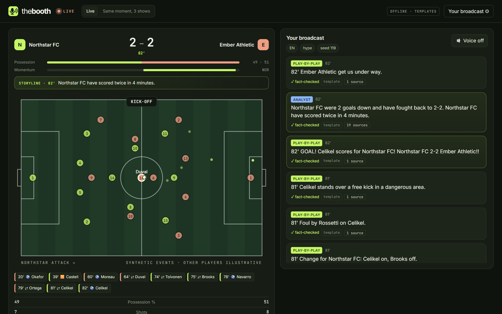
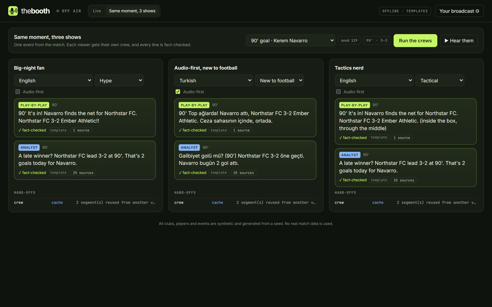
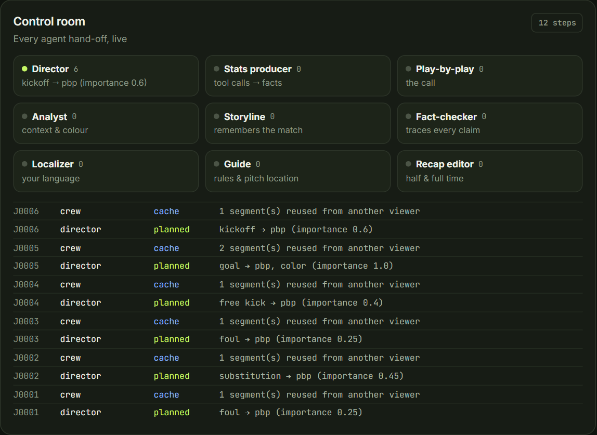
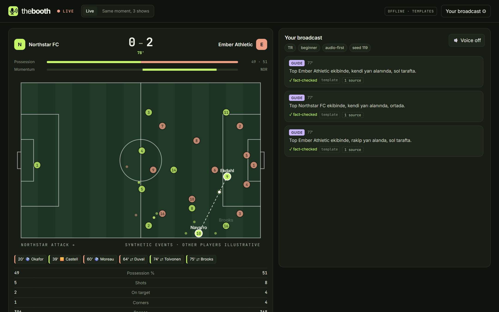
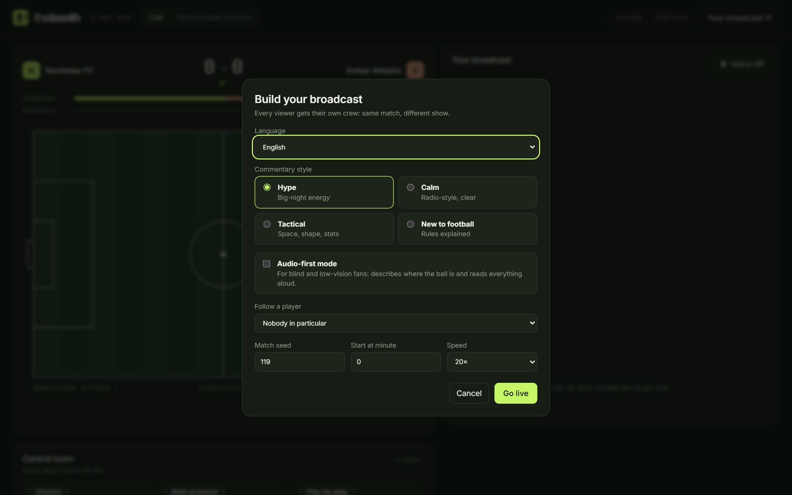
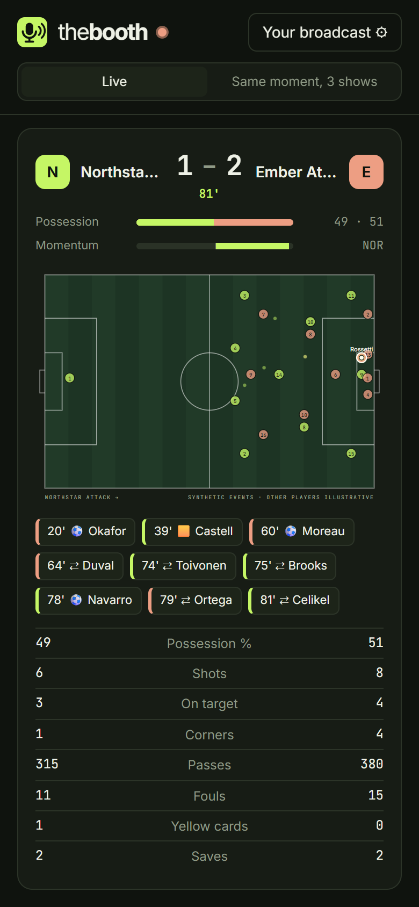
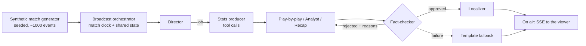

# The Booth

**An AI broadcast crew that gives every fan their own live match broadcast: in their language, in their style, and fact-checked before it goes on air.**

Built for the Microsoft × Premier League **Inside the Game** developer hackathon. All clubs, players and events are synthetic and generated from a seed. No real match data is used.

> Status: working prototype (v0.1). Runs fully offline with deterministic templates, and switches to live model-backed agents when a Microsoft Foundry (or GitHub Models) endpoint is configured.



| Same moment, three shows | The control room |
|---|---|
|  |  |

| Audio-first broadcast in Turkish | Build your broadcast | Mobile |
|---|---|---|
|  |  |  |

Try the demo match directly: `/?live=1&seed=119&lang=en&style=hype&start=76` or `/?view=compare&seed=119`.

## The problem

A live broadcast is made by a crew: a director, a play-by-play commentator, an analyst, a stats producer, graphics, a fact-checker, and a translator for every market. That crew makes **one** show, in **one** language, at **one** level of detail. Everyone else gets that one show, including:

- fans watching in a language nobody commentates in,
- people new to football who don't know what offside means,
- blind and low-vision fans, who need to hear where the ball is, not just who has it.

## What The Booth does

The Booth replays a synthetic match event-by-event and runs a **multi-agent crew per viewer**:

| Agent | Role | How it works |
|---|---|---|
| **Director** | Decides what goes on air for this viewer and in what form (call, analysis, rule explainer, location, stats, recap) | Rule-based: runs on all ~1,000 events per match in microseconds and is explainable |
| **Stats producer** | Pulls the numbers that put a moment in context | Model **tool calls** against the stats desk; every result is registered as a fact with an ID |
| **Play-by-play** | The call | Model (English world feed) or template |
| **Analyst** | One or two sentences of context | Model, may only use facts on the sheet |
| **Fact-checker** | Blocks anything that can't be traced to the data | Deterministic number and name checks, plus a model review for invented claims. Rejected drafts are **handed back** to the writer with the reasons, once |
| **Localizer** | Adapts the world feed to each viewer's language | Model translation, refused if any number changes |
| **Storyline** | Remembers the match: comebacks, late winners, braces, quick-fire goals, goals against the run of play, red cards | Deterministic tracker over the shared state; a new storyline makes the director put the analyst on air |
| **Guide** | Rule explainers for beginners; pitch locations for audio-first viewers | Deterministic |
| **Recap editor** | Half-time and full-time reports | Model or template |

The **control room** panel shows every hand-off live: what the director planned, which tools the stats producer called, which drafts the fact-checker rejected and why, and where the crew fell back.

**Same moment, 3 shows** runs several viewer profiles over one event (say, the 90th-minute winner) and puts the broadcasts side by side, each with its own hand-off trace.

### Design principles

- **Agents can't invent a number.** Numbers come from tool calls on a shared, frozen state. The fact-checker enforces it.
- **The show never stalls.** Timeouts, quota errors, a circuit breaker, a call budget (`BOOTH_LLM_MIN_IMPORTANCE`) and stale-job dropping keep the broadcast live. Every fallback is labelled.
- **One crew, many viewers.** Segments are cached per (event, profile), and the English world feed is shared before localization, so viewers with the same profile don't cost extra model calls.
- **No future leaks.** Agents read a frozen snapshot taken at the moment of the event.

## Architecture



| Layer | Technology |
|---|---|
| Agents | **Microsoft Agent Framework** (Python) — `Agent`, function tools, OpenAI-compatible chat client |
| Models | **Microsoft Foundry** model deployment (e.g. `gpt-4.1-mini`), or GitHub Models for development |
| Backend | FastAPI, Server-Sent Events |
| Voice | **Azure AI Speech** neural voices (free F0 tier) proxied by the server, browser speech synthesis as fallback |
| Frontend | Vanilla JS + SVG |
| Hosting | **Azure Container Apps**, image built by GitHub Actions and published to GitHub Container Registry |
| Observability | **Azure Monitor / Application Insights** via OpenTelemetry: a span per director job, plus Agent Framework spans for agent runs, model calls and tool calls |
| Dev | GitHub, GitHub Actions CI, GitHub Copilot |

More detail: [architecture](docs/ARCHITECTURE.md) · [deploy to Azure](docs/DEPLOY.md) · [free setup](docs/FREE_SETUP.md) · [pitch](docs/PITCH.md) · [demo script](docs/DEMO.md).

## Run it

Requires Python 3.11+.

```bash
cd backend
python -m venv .venv
.venv/Scripts/activate        # Windows; use `source .venv/bin/activate` on macOS/Linux
pip install -e ".[dev]"
uvicorn booth.api:app --port 8000
```

Open http://localhost:8000, build your broadcast (language, style, audio-first mode, a player to follow) and press **Go live**. Seed 119 is a good demo match: Ember lead 2–0 after an hour, Northstar win 3–2 with goals at 78', 82' and 90'.

Without any configuration the crew runs on deterministic templates (English and Turkish). To run the model-backed agents, copy `.env.example` to `.env` and fill in one provider. See [docs/FREE_SETUP.md](docs/FREE_SETUP.md) for the free options.

### Azure

`bash infra/deploy.sh` creates the Foundry model deployment, Application Insights and the Container App in one resource group. `--local-only` creates just the model and writes `.env`. See [docs/DEPLOY.md](docs/DEPLOY.md).

### Docker

```bash
docker build -t the-booth .
docker run -p 8000:8000 --env-file .env the-booth
```

### Evaluate the crew

```bash
cd backend
python -m booth.evaluate --seed 119 --out eval.md
```

Replays a whole match for several profiles and reports the fact-check pass rate of model drafts, rejection reasons, fallbacks and per-agent latency. Offline it gives the template baseline (pass rate 1.0).

### Tests

```bash
cd backend
pytest
ruff check booth tests
```

The tests include a scripted model that exercises the reject → rewrite hand-off, template fallback, refused translations and the circuit breaker.

## API

| Endpoint | Purpose |
|---|---|
| `GET /api/health` | Health and model status (no secrets) |
| `GET /api/options` | Languages and styles |
| `GET /api/match?seed=42` | Clubs and squads |
| `GET /api/match/events?seed=42` | Full synthetic event log |
| `GET /api/broadcast?seed=&lang=&style=&accessible=&follow=&speed=&start=` | Live broadcast as SSE: `hello`, `event`, `trace`, `segment`, `end` |
| `POST /api/ask` | `{seed, minute, question, lang}`: answered from the stats desk at that minute |
| `GET /api/moments?seed=` | Highlights worth comparing (goals, penalties, red cards, big saves) |
| `POST /api/tts` | `{text, lang}` → MP3 from Azure AI Speech (503 when not configured) |
| `POST /api/compare` | `{seed, event_id, profiles?}`: the same moment broadcast for up to 4 profiles, with traces |

## Running it in public

A public URL can burn model credit, so the server protects itself (all configurable in `.env`):

- per-client rate limits on every costly endpoint (`BOOTH_REQUESTS_PER_MINUTE`, HTTP 429),
- caps on concurrent broadcasts overall and per client (`BOOTH_MAX_STREAMS`, `BOOTH_MAX_STREAMS_PER_CLIENT`),
- a daily budget of agent runs (`BOOTH_LLM_DAILY_BUDGET`) and of speech characters (`BOOTH_SPEECH_DAILY_CHARS`); once spent, the crew switches to templates and the browser voice,
- API keys stay on the server; the browser never sees them.

## Synthetic data statement

`backend/booth/sim/match.py` generates every club, player and event from a seed using a possession-phase model (pass chains ending in shots, turnovers, fouls or offsides; cards, corners, penalties and substitutions). Averages over many seeds are tuned to look like football (≈2.7 goals and ≈32 shots per match), but it is not a calibrated physics or tracking model. "Chance quality" is a synthetic number from shot distance and angle, not an xG model.

## Team

- [@CeyhunOzcorapsiz](https://github.com/CeyhunOzcorapsiz)
- Utku Mert Geçgel — [@utkumertgecgel](https://github.com/utkumertgecgel)
- Şerif Mert Çeker — [@mrtckr05](https://github.com/mrtckr05)

An earlier exploration (Ghost Play, evidence-led tactical replays) lives in [legacy/ghost-play](legacy/ghost-play).

## License

[MIT](LICENSE)

## Contributing

See [CONTRIBUTING.md](CONTRIBUTING.md). Security reports: [SECURITY.md](SECURITY.md).
