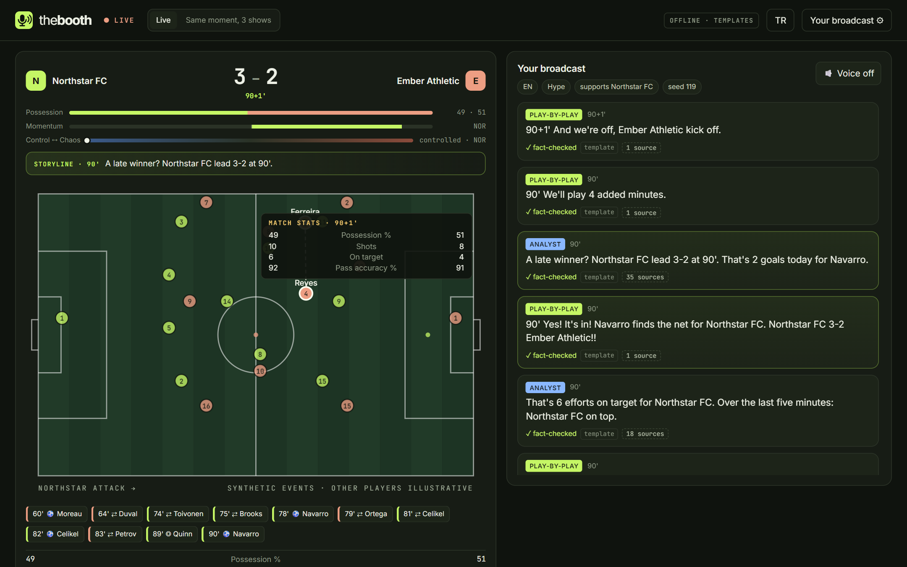
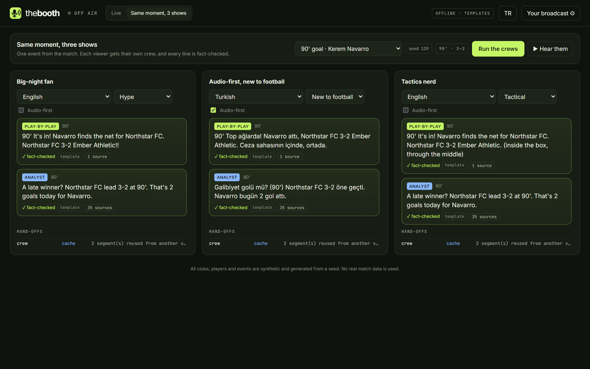
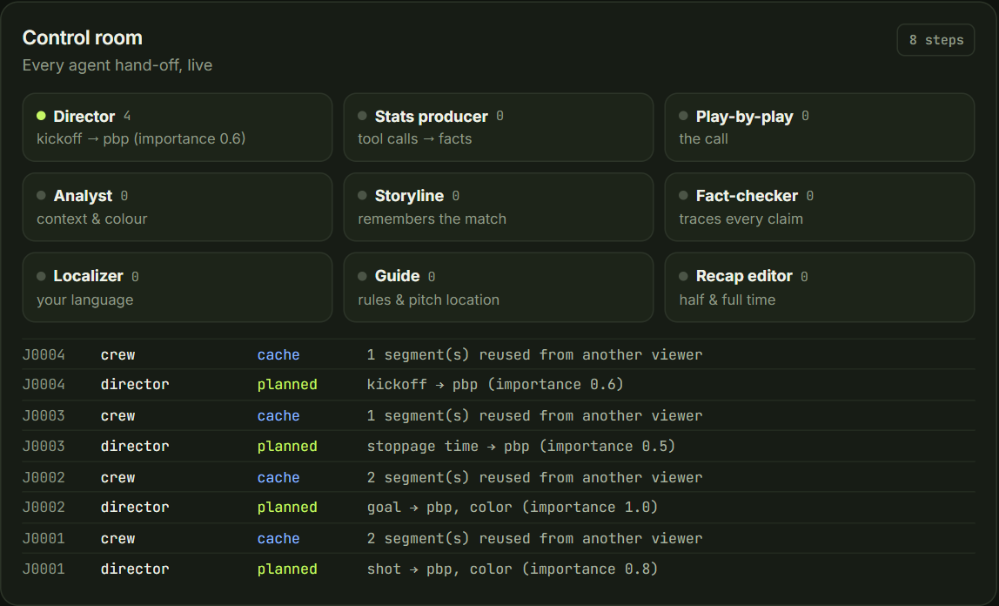
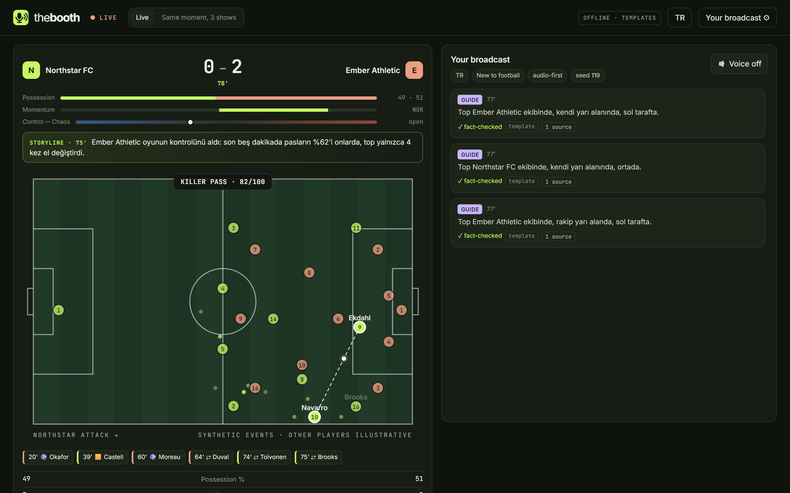
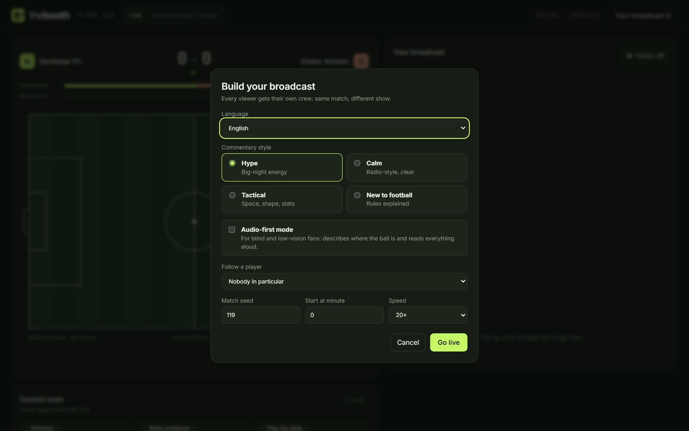
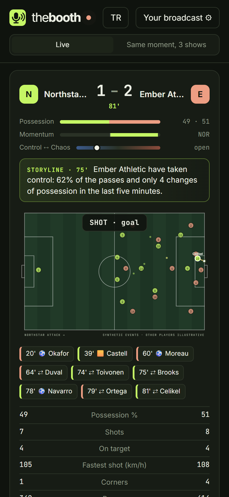
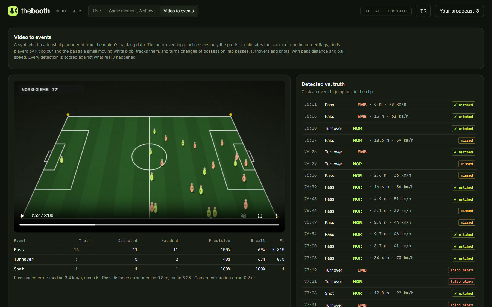

# The Booth

[English](README.md) | **Türkçe**

**Her taraftara kendi canlı maç yayınını veren bir yapay zekâ yayın ekibi: kendi dilinde, kendi
tarzında ve yayına çıkmadan önce doğruluğu kontrol edilmiş.**

Microsoft × Premier League **Inside the Game** geliştirici hackathon'u için yapıldı. Tüm kulüpler,
oyuncular ve olaylar bir tohum değerinden üretilen sentetik verilerdir; gerçek maç verisi kullanılmaz.

**Deneyin: https://ceyhunozcorapsiz.github.io/the-booth/** (statik demo, sunucu ya da model
gerekmez). Doğrudan linkler:
[Türkçe, sesli anlatım öncelikli](https://ceyhunozcorapsiz.github.io/the-booth/?live=1&lang=tr&style=beginner&accessible=1&start=76) ·
[aynı an, üç farklı yayın](https://ceyhunozcorapsiz.github.io/the-booth/?view=compare).



| Aynı an, üç farklı yayın | Kontrol odası |
|---|---|
|  |  |

| Türkçe sesli anlatım modu | Yayınını kur | Mobil |
|---|---|---|
|  |  |  |

| Videodan olaylara: piksellerden otomatik olay tespiti |
|---|
|  |

## Problem

Canlı bir yayını bir ekip yapar: yönetmen, spiker, yorumcu, istatistik sorumlusu, grafik, doğruluk
kontrolü ve her pazar için bir çevirmen. Bu ekip **tek** dilde, **tek** detay seviyesinde **tek**
bir yayın yapar. Geri kalan herkes o yayını izler:

- kimsenin anlatmadığı bir dilde izleyen taraftarlar,
- ofsaytın ne olduğunu bilmeyen yeni izleyiciler,
- topu kimin kontrol ettiğini değil nerede olduğunu duymak isteyen görme engelli taraftarlar.

## The Booth ne yapıyor

Sentetik bir maçı olay olay oynatır ve **her izleyici için çok ajanlı bir ekip** çalıştırır:

| Ajan | Görevi |
|---|---|
| **Yönetmen** | Bu izleyici için neyin, hangi biçimde yayına çıkacağına karar verir (kurallara dayalı, açıklanabilir) |
| **İstatistik sorumlusu** | Bir anı bağlamına oturtan sayıları araç çağrılarıyla çeker; her sonuç bir kimlikle kayda geçer |
| **Spiker ve yorumcu** | Anlatımı ve bir-iki cümlelik yorumu yazar; yalnızca kayıttaki gerçekleri kullanabilir |
| **Doğruluk kontrolü** | Veriye dayanmayan her şeyi engeller; reddedilen taslak gerekçesiyle yazara geri döner |
| **Yerelleştirici** | Yayını izleyicinin diline çevirir; tek bir sayı değişirse çeviriyi reddeder |
| **Maç hikâyesi** | Geri dönüşleri, son dakika gollerini, kırmızı kartları takip eder |
| **Rehber** | Yeni izleyicilere kural açıklamaları, sesli moddakilere saha konumu |

**Kontrol odası** paneli her devir teslimi canlı gösterir: yönetmen ne planladı, hangi araçlar
çağrıldı, doğruluk kontrolü hangi taslağı neden reddetti.

**Tasarım ilkeleri:** ajanlar sayı uyduramaz; yayın asla durmaz (zaman aşımı, kota ve hata
durumlarında şablonlara geçilir ve bu etiketlenir); aynı profildeki izleyiciler ek model maliyeti
oluşturmaz; ajanlar gelecekteki olayları göremez.

## Teknolojiler

| Katman | Teknoloji |
|---|---|
| Ajanlar | Microsoft Agent Framework (Python) |
| Modeller | Microsoft Foundry ya da GitHub Models |
| Backend | FastAPI, Server-Sent Events |
| Ses | Azure AI Speech, yedek olarak tarayıcı sesi |
| Frontend | Vanilla JS + SVG |
| Barındırma | Azure Container Apps, GitHub Actions |
| Gözlemlenebilirlik | Azure Monitor / Application Insights (OpenTelemetry) |
| Entegrasyon | Model Context Protocol (MCP) sunucusu |

## Çalıştırma

Python 3.11+ gerekir.

```bash
cd backend
python -m venv .venv
.venv/Scripts/activate        # Windows; macOS/Linux'ta: source .venv/bin/activate
pip install -e ".[dev]"
uvicorn booth.api:app --port 8000
```

http://localhost:8000 adresini açın, yayınınızı kurun (dil, tarz, sesli mod, takip edilecek oyuncu)
ve **Go live**'a basın. Arayüz 12 dilin hepsinde çalışır. Hiçbir ayar yapmadan ekip 12 dilde
şablonlarla çalışır; modelle çalıştırmak için `.env.example` dosyasını `.env` olarak kopyalayıp bir
sağlayıcı girin ([docs/FREE_SETUP.md](docs/FREE_SETUP.md)).

Testler: `cd backend && pytest`. Docker, Azure kurulumu, MCP sunucusu, videodan olay tespiti ve
sentetik veri dışa aktarma için İngilizce [README](README.md) ve [docs/](docs/) klasörüne bakın.

## Ekip

- [@CeyhunOzcorapsiz](https://github.com/CeyhunOzcorapsiz)
- Utku Mert Geçgel — [@utkumertgecgel](https://github.com/utkumertgecgel)
- Şerif Mert Çeker — [@mrtckr05](https://github.com/mrtckr05)

Lisans: [MIT](LICENSE)
