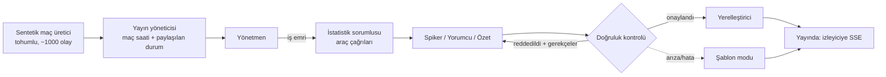

# The Booth 🎙️⚽

[English](README.md) | **Türkçe**

**Her taraftara kendi canlı maç yayınını veren bir yapay zekâ yayın ekibi: kendi dilinde, kendi tarzında ve yayına çıkmadan önce doğruluğu kontrol edilmiş.**

Microsoft × Premier League **Inside the Game** geliştirici hackathon'u için geliştirilmiştir. Tüm kulüpler, oyuncular ve olaylar bir tohum değerinden üretilen sentetik verilerdir; gerçek maç verisi kullanılmaz.

**Canlı Demo:** [https://ceyhunozcorapsiz.github.io/the-booth/](https://ceyhunozcorapsiz.github.io/the-booth/) (Statik demo, sunucu ya da model gerekmez).  
*Doğrudan bağlantılar:* [Türkçe Sesli Anlatım Modu](https://ceyhunozcorapsiz.github.io/the-booth/?live=1&lang=tr&style=beginner&accessible=1&start=76) · [Aynı An, Üç Farklı Yayın](https://ceyhunozcorapsiz.github.io/the-booth/?view=compare)

---

## 📸 Ekran Görüntüleri ve Arayüz Turu

### 1. Canlı Yayın Ekranı (Live Broadcast)
22 oyuncunun anlık takibi (1 Hz tracking), maçın ritmini ve hikâyesini özetleyen üst bant ve her satırı doğrulanmış canlı anlatım akışı.


---

### 2. Aynı Anda Üç Farklı Yayın (Same Moment, Three Shows)
90. dakikadaki galibiyet golü anında 3 farklı izleyici profili için (taktiksel, heyecanlı veya futbola yeni başlayanlar) aynı saniyede üretilen yayınların yan yana karşılaştırması.


---

### 3. Kontrol Odası (The Control Room)
Ajanlar arasındaki devir teslimin (hand-off) canlı izleme paneli. Yönetmenin planı, istatistik sorumlusunun çağırdığı araçlar (tool calls) ve doğruluk kontrolünün onayladığı veya reddettiği taslaklar anlık olarak takip edilir.


---

### 4. Türkçe Sesli Anlatım Modu (Audio-First)
Görme engelli veya maçı ekrana bakmadan dinlemek isteyen taraftarlar için topun sahanın neresinde olduğunu ("orta yuvarlağın solunda", "ceza sahası yayında") detaylandıran Türkçe betimleme akışı.


---

### 5. Yayın Kurulumu & Mobil Görünüm
Yayın dilini (Türkçe dahil 12 dil), anlatım tarzını, favori kulübü ve takip edilecek oyuncuyu seçebileceğiniz ayar ekranı ve mobil uyumlu tasarım.

| Yayınını Kur | Mobil Görünüm |
|---|---|
|  |  |

---

### 6. Videodan Olaylara: Otomatik Olay Tespiti (Vision)
Sentetik video piksellerinden pasları, top kayıplarını ve şutları otomatik tespit edip gerçek maç verisiyle (ground truth) karşılaştıran bilgisayarlı görü hattı.


---

## Problem

Canlı bir yayını bir ekip yapar: yönetmen, spiker, yorumcu, istatistik sorumlusu, grafik, doğruluk kontrolü ve her pazar için bir çevirmen. Bu ekip **tek** dilde, **tek** detay seviyesinde **tek** bir yayın yapar. Geri kalan herkes o yayını izler:

- kimsenin anlatmadığı bir dilde izleyen taraftarlar,
- ofsaytın ne olduğunu bilmeyen yeni izleyiciler,
- topu kimin kontrol ettiğini değil nerede olduğunu duymak isteyen görme engelli taraftarlar.

---

## The Booth Ne Yapıyor?

Sentetik bir maçı olay olay oynatır ve **her izleyici için çok ajanlı bir ekip** çalıştırır:



| Ajan | Görevi |
|---|---|
| **Yönetmen** | Bu izleyici için neyin, hangi biçimde yayına çıkacağına karar verir (kurallara dayalı, açıklanabilir) |
| **İstatistik sorumlusu** | Bir anı bağlamına oturtan sayıları araç çağrılarıyla çeker; her sonuç bir kimlikle kayda geçer |
| **Spiker ve yorumcu** | Anlatımı ve bir-iki cümlelik yorumu yazar; yalnızca kayıttaki gerçekleri kullanabilir |
| **Doğruluk kontrolü** | Veriye dayanmayan her şeyi engeller; reddedilen taslak gerekçesiyle yazara geri döner |
| **Yerelleştirici** | Yayını izleyicinin diline çevirir; tek bir sayı değişirse çeviriyi reddeder |
| **Maç hikâyesi** | Geri dönüşleri, son dakika gollerini, kırmızı kartları takip eder |
| **Rehber** | Yeni izleyicilere kural açıklamaları, sesli moddakilere saha konumu |

**Kontrol odası** paneli her devir teslimi canlı gösterir: yönetmen ne planladı, hangi araçlar çağrıldı, doğruluk kontrolü hangi taslağı neden reddetti.

**Tasarım ilkeleri:** ajanlar sayı uyduramaz; yayın asla durmaz (zaman aşımı, kota ve hata durumlarında şablonlara geçilir ve bu etiketlenir); aynı profildeki izleyiciler ek model maliyeti oluşturmaz; ajanlar gelecekteki olayları göremez.

---

## Teknolojiler

| Katman | Teknoloji |
|---|---|
| Ajanlar | Microsoft Agent Framework (Python) |
| Modeller | Microsoft Foundry ya da GitHub Models |
| Backend | FastAPI, Server-Sent Events |
| Ses | Azure AI Speech, yedek olarak tarayıcı sesi |
| Frontend | Vanilla JS + SVG |
| Barındırma | Azure Container Apps, GitHub Actions |
| Gözlemlenebilirlik | Azure Monitor / Application Insights (OpenTelemetry) |
| Entegrasyon | Model Context Protocol (MCP) sunucusu |

---

## Çalıştırma

Python 3.11+ gerekir.

```bash
cd backend
python -m venv .venv
.venv/Scripts/activate        # Windows; macOS/Linux'ta: source .venv/bin/activate
pip install -e ".[dev]"
uvicorn booth.api:app --port 8000
```

http://localhost:8000 adresini açın, yayınınızı kurun (dil, tarz, sesli mod, takip edilecek oyuncu) ve **Go live**'a basın. Arayüz 12 dilin hepsinde çalışır. Hiçbir ayar yapmadan ekip 12 dilde şablonlarla çalışır; modelle çalıştırmak için `.env.example` dosyasını `.env` olarak kopyalayıp bir sağlayıcı girin ([docs/FREE_SETUP.md](docs/FREE_SETUP.md)).

Testler: `cd backend && pytest`. Docker, Azure kurulumu, MCP sunucusu, videodan olay tespiti ve sentetik veri dışa aktarma için İngilizce [README](README.md) ve [docs/](docs/) klasörüne bakın.

---

## Ekip

- [@CeyhunOzcorapsiz](https://github.com/CeyhunOzcorapsiz)
- Utku Mert Geçgel — [@utkumertgecgel](https://github.com/utkumertgecgel)
- Şerif Mert Çeker — [@mrtckr05](https://github.com/mrtckr05)

Lisans: [MIT](LICENSE)
